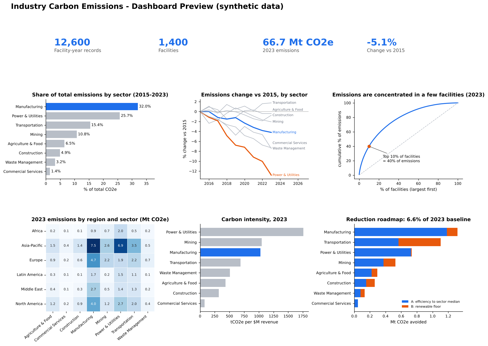

# Industry Carbon Emission Dashboard & Trend Analysis

End-to-end analytics project: raw, messy facility-level emissions data -> **PostgreSQL**
cleaning and analysis (CTEs, window functions, subqueries) -> **Python** charts ->
**Power BI** dashboard -> a quantified emission-reduction roadmap.



> **Data note:** the dataset is **synthetic** (generated by `data/generate_data.py`, seed 42),
> built to mimic a messy multi-sector facility export. Every number below is computed by the
> SQL in `sql/` from that data, so the findings describe this dataset, not real companies.

## Business questions
1. Which sectors drive the most emissions, and is that changing?
2. Where (region x sector) are emissions concentrated?
3. How concentrated are emissions among individual facilities?
4. How carbon-intensive is each sector per dollar of revenue?
5. How much could realistically be cut, and from where?

## Dataset
12,789 raw rows -> **12,600 clean facility-year records** (1,400 facilities, 8 sectors,
6 regions, 2015-2023). Columns: facility, sector, region, country, year, `co2e_tonnes`,
`energy_mwh`, `revenue_musd`, `renewable_pct`.

## Data cleaning (`sql/02_clean.sql`)
| Problem injected / found | Count | Fix |
|---|---|---|
| Exact duplicate facility-years | 189 | `ROW_NUMBER() OVER (PARTITION BY facility_id, year)` keep first |
| Inconsistent sector labels (`mfg`, `MANUFACTURING `, ...) | ~4% of rows | `CASE` on `lower(trim())` |
| Missing CO2e | 252 | impute with facility median (`percentile_cont`) |
| Negative CO2e | 24 | treated as invalid, imputed as above |
| Unit errors (kg reported as tonnes, 1000x) | 49 | detected as >20x facility median, divided by 1000 |
| Renewable share > 100% | ~25 | invalid -> sector-year median |

Every repaired row is flagged in `co2e_flag` so analysis can be re-run excluding imputed values.

## Key findings (all from `results/*.csv`)
- **Manufacturing is the largest emitter at 32.0% of total emissions (2015-2023)**, followed by
  Power & Utilities (25.7%) and Transportation (15.4%).
- Total emissions fell **5.1%** from 2015 to 2023 (70.3 -> 66.7 Mt CO2e). Power & Utilities fell
  the most (-12.8%), Manufacturing only -4.2%, and Transportation is slightly up.
- Emissions are concentrated: the **top 10% of facilities produce ~40%** of 2023 emissions.
- Asia-Pacific is the top region in 7 of 8 sectors (e.g. 35% of manufacturing emissions).
- Carbon intensity (2023): Power & Utilities 1,759 t/$M, Mining 1,050, Manufacturing 1,026,
  versus only 78 for Commercial Services.

## Reduction roadmap
Two levers on the 2023 baseline (assumptions are in the `roadmap_params` table, `sql/03_analysis.sql`):

- **A - Efficiency benchmarking:** facilities above their sector-median carbon intensity close 50% of the gap to the median.
- **B - Renewable floor:** facilities below 25% renewable share are lifted to 25%; assumes half of a facility's remaining emissions scale with its non-renewable energy mix.

**Result with these base assumptions: 4.4 Mt avoided = 6.6% of 2023 emissions** (A: 3.35 Mt, B: 1.07 Mt).
Sensitivity (`src/sensitivity.py`, `results/roadmap_sensitivity.csv`) - total reduction, % of 2023 baseline:

| Gap closed (lever A) | Renewable floor 25% | 40% | 60% |
|---|---|---|---|
| 25% | 4.2% | 9.2% | 18.6% |
| 50% | **6.6%** | 11.5% | 20.7% |
| 75% | 9.1% | 13.8% | 22.8% |
| 100% | 11.6% | 16.2% | 24.9% |

A 15%+ reduction needs aggressive assumptions (e.g. close the full intensity gap *and* reach a
40% renewable floor). The table makes that trade-off explicit.

## Repo layout
```
data/generate_data.py     synthetic data generator (seed 42)
data/emissions_raw.csv    generated raw data
sql/01_schema.sql         raw table
sql/02_clean.sql          cleaning pipeline (CTEs, window functions)
sql/03_analysis.sql       analysis views + roadmap
src/run_pipeline.py       load -> clean -> analyse -> export results/*.csv
src/make_charts.py        charts + dashboard preview
src/sensitivity.py        roadmap sensitivity grid
results/                  exported query results
images/                   charts
powerbi/README.md         Power BI build guide + DAX
```

## How to run
```bash
createdb emissions && export PGDATABASE=emissions     # needs PostgreSQL + psql
pip install pandas numpy matplotlib seaborn
python data/generate_data.py
python src/run_pipeline.py
python src/make_charts.py
python src/sensitivity.py
```

## SQL techniques used
CTEs (chained), `ROW_NUMBER`, `RANK`, `DENSE_RANK`, `NTILE`, `LAG`, `FIRST_VALUE`,
running totals (`SUM() OVER (ORDER BY ...)`), rolling `AVG ... ROWS BETWEEN`,
`percentile_cont`, `FILTER`, scalar subqueries, views, joins, indexes and constraints.
